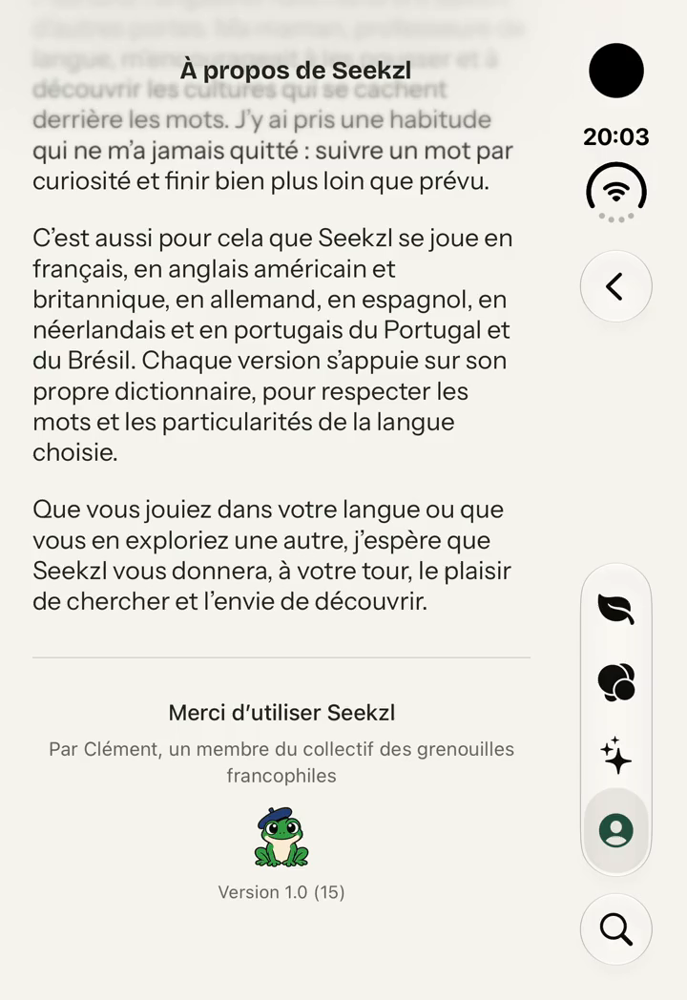
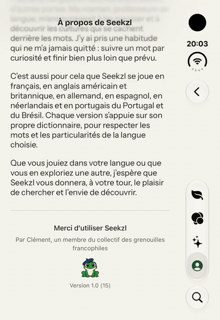

# CroaKit 🐸

Un pied de page SwiftUI pour les apps des grenouilles francophiles : typographie système, signature personnalisable, grenouille vectorielle animée avec Metal et numéro de version.

**iOS 18+ · macOS 15+ · Swift 6 · aucune dépendance externe.**

## Aperçu dans Seekzl

La grenouille dans l’écran « À propos » de Seekzl. Cliquer sur l’aperçu animé pour télécharger la vidéo MP4 à 60 images/s.

<table>
  <tr>
    <th>Capture</th>
    <th>Vidéo · 13 secondes</th>
  </tr>
  <tr>
    <td align="center">
      
    </td>
    <td align="center">
      <a href="https://github.com/cmdfio/CroaKit/raw/refs/heads/main/Documentation/Media/seekzl-preview.mp4"></a>
      <p><a href="https://github.com/cmdfio/CroaKit/raw/refs/heads/main/Documentation/Media/seekzl-preview.mp4">Télécharger la vidéo MP4 · 60 images/s</a></p>
    </td>
  </tr>
</table>

## Installation

Dans Xcode, choisir **File → Add Package Dependencies…**, coller cette URL, sélectionner **Up to Next Major Version** à partir de **1.0.0**, puis ajouter le produit **CroaKit** à la cible de l’app :

```text
https://github.com/cmdfio/CroaKit.git
```

Dans un autre package Swift, ajouter la dépendance et le produit à sa cible :

```swift
dependencies: [
    .package(url: "https://github.com/cmdfio/CroaKit.git", from: "1.0.0")
],
targets: [
    .target(
        name: "MonModule",
        dependencies: [.product(name: "CroaKit", package: "CroaKit")]
    )
]
```

Pour travailler sur le code, le dossier cloné peut aussi être ajouté à Xcode comme package local.

Les illustrations, les données du saut et le shader sont inclus dans le bundle du package. Aucun asset, fichier Metal ou réglage de police à ajouter à l’app.

## Un appel SwiftUI

```swift
import SwiftUI
import CroaKit

struct AboutView: View {
    var body: some View {
        CroaKit.footer(firstName: "Clément")
            .padding()
    }
}
```

Le nom, la version et le build sont lus dans **l’app hôte** : `CFBundleDisplayName` (ou `CFBundleName`), `CFBundleShortVersionString` et `CFBundleVersion`.

Le composant affiche, dans cet ordre :

```text
Merci d’utiliser {appName}
Conçu par {firstName}, un membre des grenouilles francophiles.

(grenouille animée)

Version {version} ({build})
```

Pour une prévisualisation ou des valeurs explicites :

```swift
CroaKit.footer(
    firstName: "Clément",
    appName: "Seekzl",
    version: "1.2",
    build: "42",
    frogWidth: 44,
    animationsEnabled: true
)
```

Tous les paramètres sauf `firstName` sont facultatifs. `frogWidth` vaut `36.96` points par défaut ; la zone tactile conserve une taille minimale de 44 points. Un espace au-dessus de la grenouille permet le saut sans recouvrir la signature. La largeur du texte est limitée à 360 points, la hauteur s’adapte aux retours à la ligne et à Dynamic Type.

`CroaFooter(...)` offre exactement les mêmes paramètres si vous préférez une vue nommée à la méthode `CroaKit.footer(...)`.

## La grenouille seule

```swift
CroaFrog(width: 80, animationsEnabled: true)
```

Elle respire, cligne des yeux toutes les 3 à 5 secondes et alterne occasionnellement bâillement, croassement et saut. Un tap déclenche un clin d’œil ; un appui long de 0,5 seconde (ou un clic maintenu sur Mac) déclenche directement le saut. L’action **Faire un saut** reste disponible pour VoiceOver.

Les animations automatiques s’arrêtent lorsque la vue disparaît, sort de la zone visible d’un `ScrollView`, ou lorsque la scène devient inactive. Le réglage système **Réduire les animations** et `animationsEnabled: false` arrêtent les mouvements automatiques et le saut ; un court clin d’œil manuel reste disponible.

La vue fonctionne aussi dans un `VStack` sans `ScrollView`. Éviter d’appliquer `.clipped()` directement à la mascotte : les bras et le béret utilisent une petite marge de rendu pendant les mouvements.

## Démonstration et vérification

Ouvrir `Examples/CroaKitDemo/CroaKitDemo.xcodeproj`, choisir le schéma **CroaKitDemo** et un simulateur iOS. La démo importe le package local et appelle uniquement `CroaKit.footer(firstName: "Clément", animationsEnabled: animations)` ; les métadonnées proviennent de sa propre cible.

Les ressources graphiques et Metal doivent être compilées par Xcode / `xcodebuild`, qui produit le catalogue d’assets et `default.metallib` dans le bundle du package. Un `swift build` seul ne remplace pas cette compilation des ressources Apple.

Depuis la racine du package :

```sh
xcodebuild -scheme CroaKit -destination 'platform=macOS' test
```

Les tests vérifient les métadonnées et leurs surcharges, les quatre illustrations, le chargement de la bibliothèque Metal depuis le bundle du package et les points de raccord partagés du visage pendant le saut. La démo permet de contrôler le rendu et les interactions sur simulateur.

## Contenu

- `CroaKit.swift`, `CroaFooter.swift`, `CroaFrog.swift` : API publique.
- `Animation/` : interpolation des formes et mouvements SwiftUI.
- `Resources/Art.xcassets` : illustrations vectorielles.
- `Resources/CroaFrog.metal` : respiration, inclinaison, trajectoire et réception du saut.
- `Resources/francophile-frog-jump.json` : poses et raccords du saut ; contour extérieur de 14 unités sur le dessin de référence, sans trait à la jonction verte/crème du visage.

Le package ne dépend d’aucun fichier du projet Seekzl, ne fait aucun appel réseau et n’inclut pas de télémétrie.
