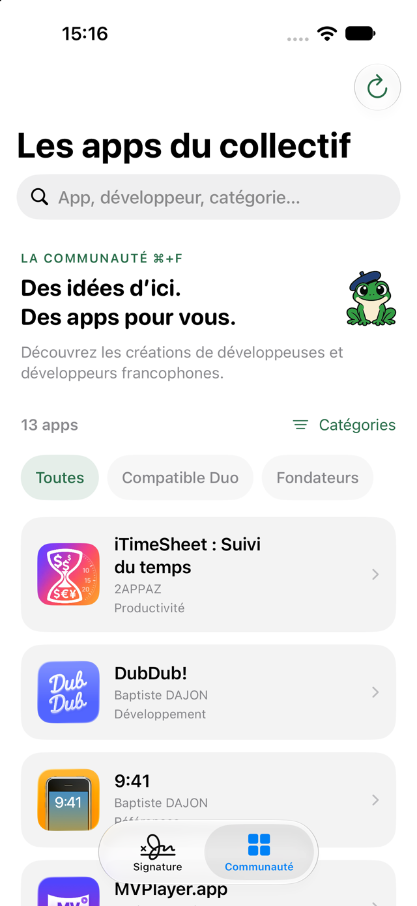
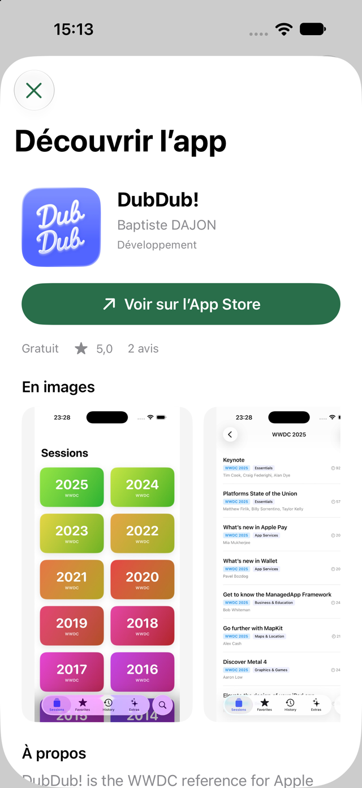

# CroaKit 🐸

Des composants SwiftUI pour les apps des grenouilles francophiles : une signature personnalisable avec grenouille animée par Metal, et une galerie connectée au catalogue d’applications de [⌘+F](https://cmdf.io).

**iOS 18+ · macOS 15+ · Swift 6 · aucune dépendance externe.**

## Aperçu dans Seekzl

La grenouille dans l’écran « À propos » de Seekzl. Cliquer sur l’aperçu animé pour télécharger la vidéo MP4 à 60 images/s.

<table>
  <tr>
    <th>Capture</th>
    <th>Vidéo · 13 secondes</th>
  </tr>
  <tr>
    <td align="center">
      
    </td>
    <td align="center">
      <a href="https://github.com/cmdfio/CroaKit/raw/refs/heads/main/Documentation/Media/seekzl-preview.mp4"></a>
      <p><a href="https://github.com/cmdfio/CroaKit/raw/refs/heads/main/Documentation/Media/seekzl-preview.mp4">Télécharger la vidéo MP4 · 60 images/s</a></p>
    </td>
  </tr>
</table>

## Installation

Dans Xcode, choisir **File → Add Package Dependencies…**, coller cette URL, sélectionner **Up to Next Major Version** à partir de **1.1.0**, puis ajouter le produit **CroaKit** à la cible de l’app :

```text
https://github.com/cmdfio/CroaKit.git
```

Dans un autre package Swift, ajouter la dépendance et le produit à sa cible :

```swift
dependencies: [
    .package(url: "https://github.com/cmdfio/CroaKit.git", from: "1.1.0")
],
targets: [
    .target(
        name: "MonModule",
        dependencies: [.product(name: "CroaKit", package: "CroaKit")]
    )
]
```

Pour travailler sur le code, le dossier cloné peut aussi être ajouté à Xcode comme package local.

Les illustrations, les données du saut et le shader sont inclus dans le bundle du package. Aucun asset, fichier Metal ou réglage de police à ajouter à l’app.

## Un appel SwiftUI

```swift
import SwiftUI
import CroaKit

struct AboutView: View {
    var body: some View {
        CroaKit.footer(firstName: "Clément")
            .padding()
    }
}
```

Le nom, la version et le build sont lus dans **l’app hôte** : `CFBundleDisplayName` (ou `CFBundleName`), `CFBundleShortVersionString` et `CFBundleVersion`.

Le composant affiche, dans cet ordre :

```text
Merci d’utiliser {appName}
Conçu par {firstName}, un membre des grenouilles francophiles.

(grenouille animée)

Version {version} ({build})
```

Pour une prévisualisation ou des valeurs explicites :

```swift
CroaKit.footer(
    firstName: "Clément",
    appName: "Seekzl",
    version: "1.2",
    build: "42",
    frogWidth: 44,
    animationsEnabled: true
)
```

Tous les paramètres sauf `firstName` sont facultatifs. `frogWidth` vaut `36.96` points par défaut ; la zone tactile conserve une taille minimale de 44 points. Un espace au-dessus de la grenouille permet le saut sans recouvrir la signature. La largeur du texte est limitée à 360 points, la hauteur s’adapte aux retours à la ligne et à Dynamic Type.

`CroaFooter(...)` offre exactement les mêmes paramètres si vous préférez une vue nommée à la méthode `CroaKit.footer(...)`.

## Les apps de la communauté

<table>
  <tr><th>Catalogue connecté</th><th>Fiche d’application</th></tr>
  <tr>
    <td></td>
    <td></td>
  </tr>
</table>

Présenter une galerie native des apps approuvées sur cmdf.io :

```swift
CroaKit.communityApps()
```

La vue inclut sa propre navigation. Elle peut servir de contenu à un onglet ou à une feuille :

```swift
struct AboutView: View {
    @State private var showsCommunity = false

    var body: some View {
        Button("Les apps du collectif") {
            showsCommunity = true
        }
        .sheet(isPresented: $showsCommunity) {
            CroaKit.communityApps(excludingAppStoreID: "1234567890")
        }
    }
}
```

`excludingAppStoreID` est facultatif : il permet de masquer l’app hôte dans les suggestions. C’est l’identifiant numérique de sa fiche App Store, pas son bundle ID. `CroaCommunityApps(...)` expose les mêmes paramètres que la méthode.

- Recherche par nom, développeur ou catégorie, sans distinction de casse ou d’accents.
- Catégories et filtres du collectif : Compatible Duo, Build Challenge, Fondateurs, lorsqu’ils sont présents.
- Fiches avec présentation, captures, prix et note lorsqu’ils sont disponibles, puis lien vers l’App Store.
- Actualisation, états de chargement, catalogue vide et nouvelle tentative après une erreur. Une actualisation échouée conserve les apps déjà affichées.
- Mise en page adaptative, mode sombre, Dynamic Type et VoiceOver.

### Connexion à cmdf.io

Le client utilise `GET https://cmdf.io/api/apps` pour le catalogue et `GET https://cmdf.io/api/apps/{slug}` à l’ouverture d’une fiche. Il reprend l’ordre défini par le collectif. Aucune clé d’API ni compte n’est nécessaire.

Les requêtes commencent quand la galerie est affichée. Les icônes et captures sont chargées depuis les URL publiques renvoyées par le service. Le cache HTTP du serveur est respecté ; la recherche et les filtres restent locaux. CroaKit n’ajoute aucune télémétrie et ne transmet pas la recherche au serveur. **Le pied de page et la grenouille seuls ne font aucun appel réseau.**

Le client peut aussi être utilisé sans l’interface :

```swift
let client = CroaCommunityClient()
let apps = try await client.apps()
if let app = apps.first {
    let detail = try await client.detail(for: app)
}
```

Pour un serveur de test compatible, injecter `CroaCommunityClient(baseURL:session:)` dans `CroaKit.communityApps(client:)`. Les tests du package utilisent une session simulée et ne dépendent pas du service en production.

## Ajouter votre application à la liste

**[Proposer mon app sur cmdf.io](https://cmdf.io/fr/apps#proposer)**

Coller le lien App Store, renseigner les coordonnées de suivi, puis ajouter une présentation et des captures si souhaité. L’équipe du collectif valide chaque proposition avant sa publication. Après validation, l’app rejoint le catalogue utilisé par CroaKit lors des prochaines actualisations, sous réserve du cache du service.

Le bouton **Ajouter mon application** de la galerie ouvre ce même formulaire. Les ajouts passent par cmdf.io : aucune modification du package ni pull request n’est nécessaire pour référencer une app.

## La grenouille seule

```swift
CroaFrog(width: 80, animationsEnabled: true)
```

Elle respire, cligne des yeux toutes les 3 à 5 secondes et alterne occasionnellement bâillement, croassement et saut. Un tap déclenche un clin d’œil ; un appui long de 0,5 seconde (ou un clic maintenu sur Mac) déclenche directement le saut. L’action **Faire un saut** reste disponible pour VoiceOver.

Les animations automatiques s’arrêtent lorsque la vue disparaît, sort de la zone visible d’un `ScrollView`, ou lorsque la scène devient inactive. Le réglage système **Réduire les animations** et `animationsEnabled: false` arrêtent les mouvements automatiques et le saut ; un court clin d’œil manuel reste disponible.

La vue fonctionne aussi dans un `VStack` sans `ScrollView`. Éviter d’appliquer `.clipped()` directement à la mascotte : les bras et le béret utilisent une petite marge de rendu pendant les mouvements.

## Démonstration et vérification

Ouvrir `Examples/CroaKitDemo/CroaKitDemo.xcodeproj`, choisir le schéma **CroaKitDemo** et un simulateur iOS. L’onglet **Signature** présente `CroaKit.footer(firstName: "Clément", animationsEnabled: animations)` avec les métadonnées de la cible ; l’onglet **Communauté** présente `CroaKit.communityApps()`.

Les ressources graphiques et Metal doivent être compilées par Xcode / `xcodebuild`, qui produit le catalogue d’assets et `default.metallib` dans le bundle du package. Un `swift build` seul ne remplace pas cette compilation des ressources Apple.

Depuis la racine du package :

```sh
xcodebuild -scheme CroaKit -destination 'platform=macOS' test
```

Les tests vérifient les métadonnées, les illustrations, la bibliothèque Metal, les raccords du visage et le contrat réseau du catalogue : erreurs HTTP, réponses invalides, filtrage, doublons, liens et conservation des données après un échec d’actualisation. La démo permet de contrôler le rendu et les interactions sur simulateur.

## Contenu

- `CroaKit.swift`, `CroaFooter.swift`, `CroaFrog.swift` : API publique.
- `Animation/` : interpolation des formes et mouvements SwiftUI.
- `Community/` : galerie SwiftUI, fiches, modèles et client du catalogue cmdf.io.
- `Resources/Art.xcassets` : illustrations vectorielles.
- `Resources/CroaFrog.metal` : respiration, inclinaison, trajectoire et réception du saut.
- `Resources/francophile-frog-jump.json` : poses et raccords du saut ; contour extérieur de 14 unités sur le dessin de référence, sans trait à la jonction verte/crème du visage.

Le package ne dépend d’aucun fichier du projet Seekzl et n’inclut pas de télémétrie.

## Licence et contributions

Le **code est sous [licence MIT](LICENSE)**. La **grenouille est réservée au collectif**, selon [ARTWORK-LICENSE.md](ARTWORK-LICENSE.md). Les icônes et captures des apps restent la propriété de leurs titulaires respectifs.

Pour contribuer au code ou signaler un problème : [CONTRIBUTING.md](CONTRIBUTING.md). Merci aux [personnes qui contribuent](CONTRIBUTORS.md).
